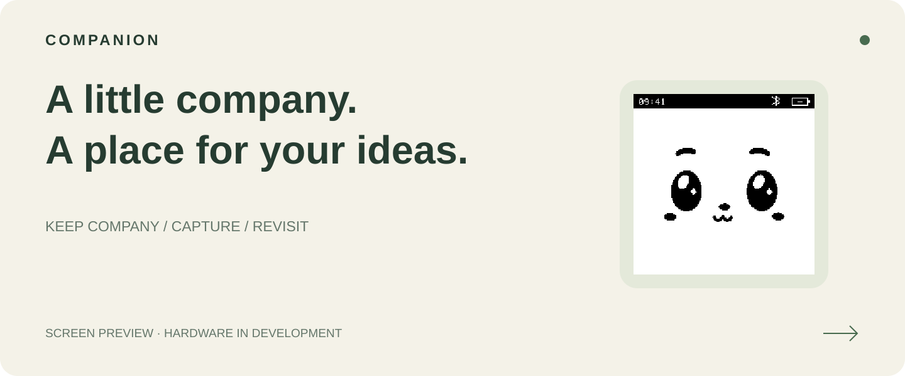

<picture>
  <source media="(prefers-color-scheme: dark) and (max-width: 600px)" srcset="docs/assets/companion/hero-en-mobile-dark.svg">
  <source media="(prefers-color-scheme: dark)" srcset="docs/assets/companion/hero-en-dark.svg">
  <source media="(max-width: 600px)" srcset="docs/assets/companion/hero-en-mobile.svg">
  
</picture>

**English** · [简体中文](README.zh-CN.md)

# Companion Firmware

**The behavior inside Companion: expression, touch, capture, safekeeping and the way home.**

[Meet the firmware](#what-lives-on-the-device) · [Physical controls](#record-with-the-device) · [Readiness](docs/STATUS.md) · [Desktop Type](https://github.com/Listener-ai-Macau/Companion-Type)

> **FW1.1.18 / UI36 development candidate · New WBA hardware validation pending.** The software candidate and host evidence are prepared; whole-product acceptance is not complete. These screen previews are not new-board photographs or live readings.

## What lives on the device

| A small companion | A recorder you can carry | A careful handoff |
| --- | --- | --- |
| Expressions, natural blinking, an accessory clock and nonverbal pet sounds. | Physical-button capture, visible preparing/recording/saving states and local Opus storage. | Bluetooth catalog and offset transfer, integrity checks, retry, and exact acknowledgement before reclaim. |

  

Touching Companion can turn its gaze, change its expression and play a short pet cue. Picking it up or shaking it can create a visual response. Quiet mode reduces motion-triggered reactions and silences routine cues while retaining natural blinking.

The first version does not listen for its name, use a wake word, speak with TTS or offer voice conversation.

## Record with the device

1. With the device awake, hold the physical button for about 700 ms.
2. Companion prepares storage, shows the recording transition and plays the start cue before enabling the microphone.
3. Hold the button again for about 700 ms to stop. The microphone turns off, then a low pet grumble marks the end of capture; only the `SAVED` screen after journal finalization confirms a successful save.
4. Return to Windows Type over Bluetooth to sync the recording, then listen, transcribe and organize it.

The first complete press from sleep wakes the device without starting a recording. A short press is only a confirmation action. Holding again while storage is still preparing cancels the start. Quiet mode silences the start and stop cues, while the same capture, finalization and visible-status sequence continues.

Capture requires a ready microphone and recording store. A storage transfer or update can delay it, and insufficient contiguous space can refuse or stop it. The device defaults to a 30-minute limit, with 15/30/60/no-timer settings; no-timer remains capacity-limited. Gapless automatic segmentation is not available.

## Designed to keep a recording recoverable

- Recording metadata uses a journal so incomplete work is not presented as finalized.
- Unsynced recordings are not silently reclaimed when storage fills.
- Bluetooth transfer can resume from an offset and checks length, CRC and SHA before exact reclaim acknowledgement.
- Application and resource updates use signed component identities and rollback/anti-rollback rules.
- A read-only UART diagnostic report can expose identity and major subsystem fault state after firmware is installed.

These paths have host and software fault-injection evidence. Real microphone acoustics, NOR timing and endurance, radio behavior, power-loss recovery and the complete board-to-Type chain still require the new WBA board. See [readiness and limits](docs/STATUS.md).

## One product, three parts

| Repository | Responsibility |
| --- | --- |
| [Companion Type](https://github.com/Listener-ai-Macau/Companion-Type) | Connection, sync, local playback, library, transcription, minutes, editing and export |
| Companion Firmware (here) | Expressions, interaction, capture, storage, Bluetooth transfer, pet sounds, update and recovery |
| [Companion Hardware](https://github.com/Listener-ai-Macau/Companion-Hardware) | Electronics, enclosure, manufacturing data and board validation |

Routine use does not require a phone or a debug cable. USB-C supplies power only on the current PCB; initial installation and maintenance use the six-pin connector. Hardware acceptance remains pending, so this page does not claim production availability, measured battery life or an out-of-box finished product.

[Development and original engineering notes](docs/DEVELOPMENT.md) · [简体中文](README.zh-CN.md)
