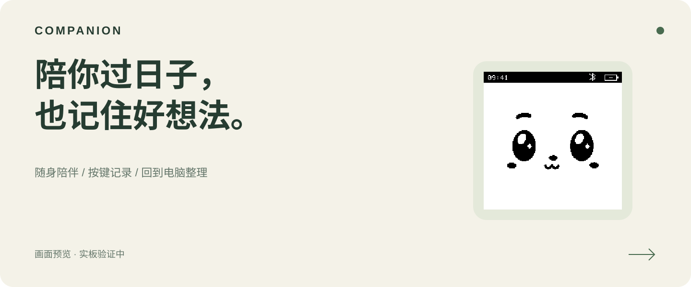

<picture>
  <source media="(prefers-color-scheme: dark) and (max-width: 600px)" srcset="docs/assets/companion/hero-zh-mobile-dark.svg">
  <source media="(prefers-color-scheme: dark)" srcset="docs/assets/companion/hero-zh-dark.svg">
  <source media="(max-width: 600px)" srcset="docs/assets/companion/hero-zh-mobile.svg">
  
</picture>

[English](README.md) · **简体中文**

# Companion Firmware

**Companion 身体里的行为：表情、触摸、记录、保管，以及把内容带回电脑。**

[固件做什么](#留在设备里的能力) · [物理按键录音](#直接用设备录音) · [当前进度](docs/STATUS.zh-CN.md) · [桌面 Type](https://github.com/Listener-ai-Macau/Companion-Type)

> **FW1.1.18 / UI36 开发候选 · 新 WBA 实板待验证。** 软件候选与主机侧证据已经准备；整机验收尚未完成。下方是已有屏幕画面预览，不是新板实拍或现场读数。

## 留在设备里的能力

| 一个小伙伴 | 可以随身带的录音机 | 谨慎交回电脑 |
| --- | --- | --- |
| 表情、自然眨眼、独立饰品时钟和非语言宠物声音。 | 物理按键录音、清楚的准备/录音/保存状态和本地 Opus 存储。 | 蓝牙录音目录、按偏移续传、完整性校验、重试，以及确认无误后才精确回收。 |

  

摸一摸 Companion，它可以转向触点、改变表情并播放一小段宠物提示音；拿起或摇动时可以有视觉回应。安静模式会减少动作触发的表情并关闭日常提示音，自然眨眼仍会保留。

第一版不会听名字，没有唤醒词，不用 TTS 说话，也不提供语音对话。

## 直接用设备录音

1. 设备醒着时，长按物理按键约 700 毫秒。
2. Companion 准备存储、显示录音过渡；起录提示完成后才打开麦克风。
3. 再长按约 700 毫秒停止。麦克风先关闭，再用一声低低的宠物咕噜声表示采集结束；只有日志收尾完成后屏幕显示 `SAVED`，才代表保存成功。
4. 回到 Windows Type，通过蓝牙同步录音，再回听、转写与整理。

从睡眠状态开始的第一次完整按压只负责唤醒，不会同时开始录音。短按只做确认操作。存储仍在准备时再次长按，可以取消本次启动。安静模式下起录和停止提示不发声，但采集、收尾及屏幕状态流程照常进行。

录音要求麦克风与录音存储可用；存储传输或升级可能让它延后，连续空间不足会拒绝或提前停止。设备默认 30 分钟，可选 15/30/60/不限时；“不限时”仍受容量限制。当前没有无缝自动分段。

## 让录音保持可恢复

- 录音元数据使用日志，未完成内容不会冒充已完成录音。
- 存储写满时，不会静默淘汰尚未同步的录音。
- 蓝牙传输支持按偏移续传，并在精确回收确认前检查长度、CRC 与 SHA。
- 应用与资源升级带签名组件身份，并遵守回滚与防降级规则。
- 固件安装后，可通过只读串口诊断报告查看身份及主要子系统故障状态。

这些路径已有主机侧和软件故障注入证据。真实麦克风声学、NOR 时序与寿命、无线表现、断电恢复和新板到 Type 的完整链路仍需 WBA 实板。范围见 [当前进度](docs/STATUS.zh-CN.md)。

## 一个产品，三个部分

| 仓库 | 负责什么 |
| --- | --- |
| [Companion Type](https://github.com/Listener-ai-Macau/Companion-Type) | 连接、同步、本地回听、会议库、转写、纪要、编辑与导出 |
| Companion Firmware（这里） | 表情、交互、录音、存储、蓝牙传输、宠物声音、升级与恢复 |
| [Companion Hardware](https://github.com/Listener-ai-Macau/Companion-Hardware) | 电路、结构、制造资料与实板验证 |

日常使用不需要手机或调试线。当前 PCB 的 USB-C 仅供电；首次安装和维护使用六针接口。硬件尚未完成验收，因此这里不承诺已量产、实测续航或开箱即用的成品状态。

[开发与原工程说明](docs/DEVELOPMENT.md) · [English](README.md)
